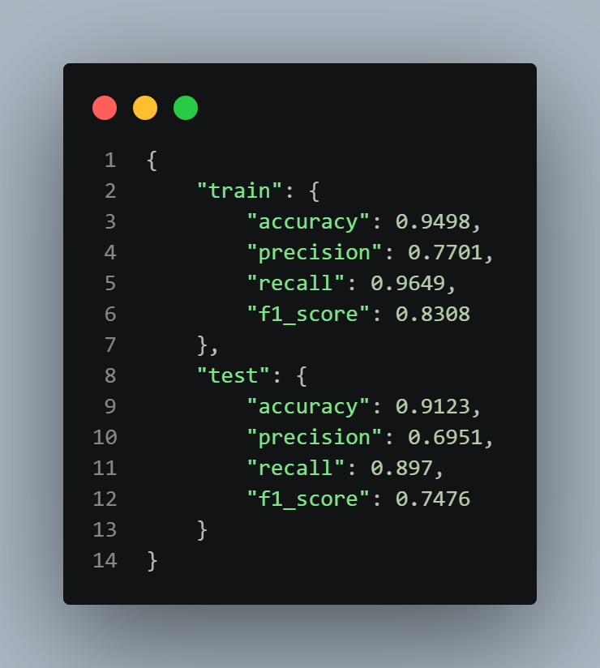

# Diabetes Risk Analysis & Predictive Modeling
An End-to-End Healthcare Data Analytics and Machine Learning Case Study

---

## Project Overview

This project explores a healthcare dataset of 50,000 patient records to understand diabetes risk patterns and build a reliable, scientifically grounded machine learning classification model.

The project is structured in two connected phases:
1. **Phase 1: Exploratory Data Analysis & Interactive Excel Dashboard** — Examining patient distributions, key clinical biomarkers (HbA1c, glucose, BMI), lifestyle factors, and demographic segments.
2. **Phase 2: Supervised Machine Learning & Recall Optimization** — Transitioning from descriptive analysis to predictive modeling, auditing data leakage, establishing baseline benchmarks, and solving a severe minority-class imbalance problem through cross-validation and probability threshold optimization.

```
Diabetes_Risk_Project/
├── Diabetes_Risk_Cleaning.xlsx          # Raw & cleaned clinical records (50,000 patients)
├── diabetes_risk_classification.py      # Complete Python ML pipeline (Scikit-learn & XGBoost)
├── results.json                         # Exported evaluation metrics (Train & Test sets)
├── image/
│   ├── Screenshot 2026-11-05 232404.png # Excel analysis dashboard screenshot
│   └── code.png                         # Model execution and evaluation output
└── README.md                            # Comprehensive project documentation
```

---

# Part 1: Exploratory Analysis & Interactive Dashboard

The first stage of the project focused on exploring the dataset in Excel to uncover how diabetes risk categories are distributed across clinical measurements, demographic indicators, and daily lifestyle habits.

The target variable across the analysis is `Diabetes_Risk`, divided into three categories:
- **High Risk**
- **Moderate Risk**
- **Low Risk**

The dashboard was built in Excel using PivotTables, KPI cards, comparative charts, and interactive slicers to make patterns easier to navigate and evaluate.


---

### 1. Overall Risk Distribution

The dataset contains exactly 50,000 verified patient records:

| Risk Category | Number of Patients | Percentage |
| :--- | :---: | :---: |
| **High Risk** | 36,593 | 73.19% |
| **Moderate Risk** | 12,937 | 25.87% |
| **Low Risk** | 470 | 0.94% |
| **Total** | **50,000** | **100.0%** |

High Risk is by far the largest category, representing more than seven out of every ten patients in the dataset. Moderate Risk accounts for roughly one quarter, while Low Risk makes up less than 1% of all records.

This substantial class imbalance is a critical finding. It shapes how every chart should be read, and as discussed in Part 2, it presents a major technical challenge when training machine learning algorithms.

---

### 2. Age and Diabetes Risk

The age distribution chart compares how risk categories shift across different age brackets. 

The general trend in the data indicates that older age groups show a noticeably higher proportion of High Risk records, while the share of Low and Moderate categories gradually decreases. 

*Analytical Note:* This observation describes the composition of this specific dataset at a single point in time. It shows an association between age brackets and risk categories, rather than proving that aging alone causes diabetes.

---

### 3. Blood Glucose and Diabetes Risk

Average blood glucose levels across the three categories appear relatively close in the displayed charts, with High Risk showing slightly higher averages and Low Risk slightly lower.

Because the visual differences between category averages are narrow, this metric requires careful interpretation. A simple average can mask the true variance and spread of individual readings. In clinical contexts, isolated glucose readings fluctuate based on recent meals, making long-term measures like HbA1c essential for a more complete picture.

---

### 4. HbA1c and Diabetes Risk

In contrast to single-point blood glucose, the average HbA1c chart demonstrates a clearer, more consistent separation:
- **High Risk:** Shows the highest average HbA1c levels.
- **Moderate Risk:** Sits squarely between High and Low.
- **Low Risk:** Displays the lowest average HbA1c levels.

This gradient aligns well with medical expectations, as glycated hemoglobin reflects average blood sugar control over an extended 2-to-3-month window.

---

### 5. Body Mass Index (BMI) and Diabetes Risk

Average BMI follows a pattern similar to HbA1c:
- High Risk patients exhibit the highest average BMI.
- Moderate Risk falls in the middle range.
- Low Risk shows the lowest average BMI.

While this suggests an overall positive relationship between BMI and elevated risk in this cohort, BMI remains a general screening metric that should always be interpreted alongside waist circumference and clinical lab values.

---

### 6. Physical Activity, Age Groups, and Risk

This view breaks down patient volumes across risk tiers, age groups, and physical activity levels. Using the dashboard slicers for **Age Group** and **Physical Activity Level**, viewers can filter specific subsets of patients and see how the proportions shift.

When viewing filtered segments, total group sizes should always be taken into account; a higher absolute patient count in an active segment often reflects that more people fall into that demographic overall, rather than an elevated risk rate.

---

### 7. Diet Quality, Sugar Intake, and Lifestyle Patterns

This section looks at how dietary self-reporting intersects with diabetes risk. It includes interactive slicers for:
- **Diet Quality** (Healthy, Average, Poor)
- **Sugar Intake Level** (Low, Moderate, High)

Filtering across combinations helps illustrate how reported lifestyle habits correspond to risk tiers. As with the demographic charts, these patterns represent self-reported observational correlations rather than direct causal proof.

---

### 8. Dashboard Interactivity

The Excel dashboard uses four connected slicers to let viewers filter and explore subgroups dynamically:
- **Age Group** (18-29, 30-39, 40-49, 50-59, 60-69, 70-79, 80-90)
- **Physical Activity Level** (Low, Moderate, High)
- **Diet Quality** (Healthy, Average, Poor)
- **Sugar Intake Level** (Low, Moderate, High)

These interactive controls help move beyond aggregate averages and allow focused exploration of specific patient cohorts.

---

### 9. Key Takeaways from the Descriptive Analysis

1. **Heavy Skew Toward High Risk:** 73.19% of the population is classified as High Risk, while Low Risk represents an extreme minority at 0.94% (470 patients).
2. **Clear Biomarker Gradients:** HbA1c and BMI show distinct separation across the three risk tiers.
3. **Subtle Glucose Differences:** Spot blood glucose averages are relatively close across categories, suggesting that isolated glucose values alone may be insufficient to distinguish risk levels.
4. **Lifestyle Correlations:** Higher physical activity and healthier diet choices correspond with lower proportions of High Risk records within comparable age brackets.

---

# Part 2: Supervised Machine Learning & Recall Optimization

While the Excel dashboard provided valuable descriptive insights, the second phase of the project aimed to build an automated, reliable predictive model to classify a patient's diabetes risk category using their demographic, physiological, and lifestyle features.



---

### 1. Problem Formulation & Clinical Context

- **Task:** Multiclass Supervised Classification.
- **Target Variable:** `Diabetes_Risk` (`High`, `Moderate`, `Low`).
- **Clinical Role:** Risk stratification and preventive screening tool. It is designed to flag patients who may need earlier lifestyle counseling or further diagnostic lab tests; it is **not** a diagnostic device.

---

### 2. Data Hygiene & Data Leakage Prevention

Before running any algorithms, an audit of the raw Excel dataset revealed two critical integrity issues that had to be addressed:

#### A. Removal of Descriptive Summary Rows
The raw spreadsheet contained 50,007 rows. Inspecting the final 7 rows revealed that they were summary statistics appended during initial Excel analysis (containing `Total`, `Mean`, `Median`, `Min`, `Max`, `Std`, and trailing zero values). These 7 non-patient rows were removed to leave exactly **50,000 legitimate patient records**.

#### B. Eliminating Target Leakage (The Investigative Audit)
To ensure the model learns genuine clinical signals rather than artificial shortcuts, four variables were excluded from the feature set:

1. **`Patient_ID`:** An administrative row index with zero predictive value.
2. **`Diabetes_Risk_Score` (Direct Deterministic Leakage):** Cross-referencing this score against `Diabetes_Risk` proved that the target variable was generated by slicing this exact score:
   - $\text{Low Risk} \le 34$
   - $\text{Moderate Risk} \in [35, 64]$
   - $\text{High Risk} \ge 65$  
   Leaving this column in would allow a decision tree to achieve a fake 100% accuracy with two simple threshold splits, producing an entirely useless model for real clinical screening.
3. **`AI_Health_Recommendation` (Post-Hoc Leakage):** Cross-tabulation revealed that every recommendation was 100% mutually exclusive to a single risk category (e.g., *"Begin Diabetes Management Plan"* exists *only* in High Risk; *"Annual Diabetes Screening"* exists *only* in Low Risk). This is an outcome recommendation assigned after risk is established.
4. **`Doctor_Consultation_Needed` (Downstream Clinical Action):** 100% of High Risk patients had `"Yes"` while 88.7% of Low Risk had `"No"`. This reflects a downstream clinical triage decision rather than an antecedent predictor.

#### Retained Predictors (38 Genuine Features)
- **20 Numerical Biomarkers:** `Age`, `Height_cm`, `Weight_kg`, `BMI`, `Waist_Circumference_cm`, `Blood_Glucose`, `HbA1c`, `Fasting_Blood_Sugar`, `Insulin_Level`, `Blood_Pressure_Systolic`, `Blood_Pressure_Diastolic`, `Total_Cholesterol`, `HDL`, `LDL`, `Triglycerides`, `Heart_Rate`, `Exercise_Hours_Per_Week`, `Daily_Walking_Minutes`, `Sleep_Hours`, `Daily_Water_Intake_L`.
- **18 Categorical / Demographic Indicators:** `Age_Group`, `Gender_Cleaned`, `Country_Cleaned`, `BMI_Group`, `Physical_Activity_Level`, `Diet_Quality`, `Sugar_Intake_Level`, `Stress_Level`, `Smoking_Status`, `Alcohol_Consumption`, `Family_History_Diabetes`, `Hypertension`, `Heart_Disease`, `Fatty_Liver`, `PCOS`, `Medication_Adherence`, `Work_Type`, `Residence_Type`.

---

### 3. Validation Strategy: Strict 80/20 Stratified Split

The 50,000 patient records were divided into:
- **80% Training Set:** 40,000 records
- **20% Testing Set:** 10,000 records (isolated and untouched until final evaluation)
- **Random Seed:** `random_state=42`
- **Stratification:** Preserved the exact class distribution across both splits:
  - High Risk: 73.19% (29,274 train / 7,319 test)
  - Moderate Risk: 25.87% (10,350 train / 2,587 test)
  - Low Risk: 0.94% (376 train / 94 test)

All preprocessing transformations (median imputation and standard scaling for numericals, mode imputation and one-hot encoding for categoricals) were wrapped inside a Scikit-learn `Pipeline` to prevent any information from the test set leaking into the training process.

---

### 4. The Baseline Model & The Minority Class Problem

We started with a standard `RandomForestClassifier` using `class_weight="balanced"`.

While the baseline model achieved an apparently impressive **90.59% overall accuracy**, looking beneath the surface revealed a critical failure on the minority class:

| Class | Precision | Recall (Sensitivity) | F1-Score | Test Support |
| :--- | :---: | :---: | :---: | :---: |
| **High Risk** | 0.9517 | 0.9311 | 0.9413 | 7,319 |
| **Moderate Risk** | 0.7902 | 0.8663 | 0.8265 | 2,587 |
| **Low Risk** | **1.0000** | **0.0319** | **0.0619** | **94** |

**Out of 94 Low Risk patients in the test set, the baseline model correctly identified only 3.** 

#### Why Did This Happen?
Inspecting the predicted probability distributions on out-of-fold training data explained the mechanism:
- For genuine Low Risk patients, the model predicted an average probability $P(\text{Low}) \approx 21.5\%$.
- For non-Low patients (High and Moderate), the average $P(\text{Low})$ was only $\approx 1.0\%$.
- Even though the model clearly separated Low Risk patients (a 21-fold difference in probability), standard classification applies a default `argmax` rule (picking the class with the highest probability). Because Low Risk patients still averaged $P(\text{Moderate}) \approx 68.0\%$, `argmax` almost never assigned the Low label, defaulting 91 of the 94 patients into Moderate Risk.

---

### 5. Systematic 5-Fold Cross-Validation Experiments

To address this issue scientifically, we ran 5-Fold Stratified Cross-Validation on the training data alone, evaluating several techniques:

| Approach / Model Tested | CV Accuracy | CV Macro Recall | CV Macro F1 | Low Risk Recall | Notes / Behavior |
| :--- | :---: | :---: | :---: | :---: | :--- |
| **1. Random Forest (`balanced`)** | 0.8986 | 0.5958 | 0.5931 | 0.0160 | Baseline: fails on minority class due to argmax |
| **2. Random Forest (Custom Weights Low x3)** | 0.8924 | 0.6023 | 0.5937 | 0.0213 | Marginal improvement; still struggles with decision threshold |
| **3. RandomOverSampler + Random Forest** | 0.8958 | 0.5638 | 0.5746 | 0.0027 | Oversampling caused trees to overfit synthetic boundaries |
| **4. Extra Trees Classifier (`balanced`)** | 0.8278 | 0.4633 | 0.4817 | 0.0000 | Over-randomized splits washed out the subtle Low Risk signal |
| **5. XGBoost (Standard Argmax)** | 0.9262 | 0.8098 | 0.8019 | 0.5612 | Gradient boosting captured non-linear biomarker interactions better |
| **6. XGBoost + OOF Threshold ($T = 0.14$)** | **0.9168** | **0.8926** | **0.7633** | **0.8564** | **Best balance: high recall across all three classes** |

#### Selecting the Winning Model
Using out-of-fold cross-validation probabilities on the training set, we optimized a decision threshold $T$ for the Low Risk class:
$$\text{If } P(\text{Low}) \ge 0.14 \implies \text{Classify as Low Risk; else } \operatorname{argmax}(P(\text{High}), P(\text{Moderate}))$$

This decision rule was locked in **purely based on the 5-fold CV results on the training set**, keeping the test set completely blind.

---

### 6. Final Evaluation on the Untouched Test Set

The winning architecture (XGBoost with balanced sample weights and the CV-derived $T=0.14$ threshold) was trained on the full 80% training set and evaluated on the untouched 20% test set ($N=10,000$).

#### Performance Comparison Table

| Evaluation Metric | Original Baseline (Random Forest) | Improved Model (XGBoost + Threshold) | Absolute Change |
| :--- | :---: | :---: | :---: |
| **Accuracy** | 0.9059 (90.59%) | **0.9123 (91.23%)** | **+0.64%** |
| **Macro Precision** | 0.9140 | **0.6951** | -21.89% (Trade-off) |
| **Macro Recall (Primary Goal)** | 0.6098 | **0.8970** | **+28.72%** |
| **Macro F1-Score** | 0.6099 | **0.7476** | **+13.77%** |
| **Weighted F1-Score** | 0.9033 | **0.9184** | **+1.51%** |
| **High Risk Recall** | 0.9311 | **0.9220** | -0.91% (Stable) |
| **Moderate Risk Recall** | 0.8663 | **0.8860** | **+1.97%** |
| **Low Risk Recall** | **0.0319 (3.19%)** | **0.8830 (88.30%)** | **+85.11%** |

---

### 7. Confusion Matrix Comparison

#### Baseline Model (Random Forest, Untouched Test Set):
```
                 Predicted High  Predicted Moderate  Predicted Low
Actual High           6,815              504               0
Actual Moderate         346            2,241               0
Actual Low                0               91               3  <-- Only 3 detected
```

#### Improved Model (XGBoost + Threshold $T=0.14$, Untouched Test Set):
```
                 Predicted High  Predicted Moderate  Predicted Low
Actual High           6,748              571               0
Actual Moderate         104            2,292             191
Actual Low                0               11              83  <-- 83 detected!
```

---

### 8. Clinical Interpretation of the Trade-Offs

1. **Massive Sensitivity Improvement on Low Risk:**
   - The baseline model missed 91 of 94 Low Risk patients (3.19% recall).
   - The improved model correctly flagged **83 of 94 patients (88.30% recall)**, representing an 85% net increase in minority-class detection.
2. **Understanding the Precision Drop (30.29% for Low Risk):**
   - Out of 10,000 patients, the model predicted 274 individuals as Low Risk. Of those, 83 were true Low Risk and 191 were Moderate Risk, yielding a precision of $83 / 274 \approx 30.29\%$.
   - In preventive health screening, classifying a Moderate Risk patient as Low Risk means they receive standard wellness and lifestyle advice rather than an aggressive intervention. This is an acceptable operational trade-off to avoid missing 97% of low-risk individuals.
3. **The Critical Safety Boundary:**
   - **0 High Risk patients were misclassified as Low Risk.**
   - **0 Low Risk patients were misclassified as High Risk.**
   - The boundary separating severe metabolic risk from healthy patients remained 100% intact, ensuring that patients needing immediate clinical attention were never sent home with a false clean bill of health.

---

### 9. Summary of Saved JSON Outputs

The script exports the simplified metrics for both training and testing directly to [`code.png`](image/code.png):

```json
{
    "train": {
        "accuracy": 0.9498,
        "precision": 0.7701,
        "recall": 0.9649,
        "f1_score": 0.8308
    },
    "test": {
        "accuracy": 0.9123,
        "precision": 0.6951,
        "recall": 0.897,
        "f1_score": 0.7476
    }
}
```

- **`train`:** Reflects model fit on the 40,000 training records.
- **`test`:** Reflects genuine generalization performance on the 10,000 unseen patients.

---

## How to Run the Code

To reproduce all results, cross-validation benchmarks, and final metrics from scratch:

```powershell
# 1. Clone or navigate to the project directory
cd "Diabetes_Risk_Project"

# 2. Run the pipeline script
python diabetes_risk_classification.py
```

The script will ingest `Diabetes_Risk_Cleaning.xlsx`, perform the stratified split, execute the 5-fold CV comparisons, retrain the selected model, print the full report, and update `results.json` automatically.

---

## Conclusion

This project demonstrates the transition from descriptive data analysis to rigorous machine learning engineering:
- **Phase 1** revealed critical cohort characteristics: the dominance of High Risk patients, the 0.94% rarity of Low Risk patients, and clear physiological separation in HbA1c and BMI.
- **Phase 2** turned these insights into an operational classifier. By auditing data leakage, identifying the mathematical reason why tree models fail on rare classes under default decision rules, and optimizing probability thresholds via cross-validation, we transformed an unviable baseline into an effective screening tool that achieves **89.70% Macro Recall** and **88.30% Low Risk detection** while maintaining a safe clinical boundary.

